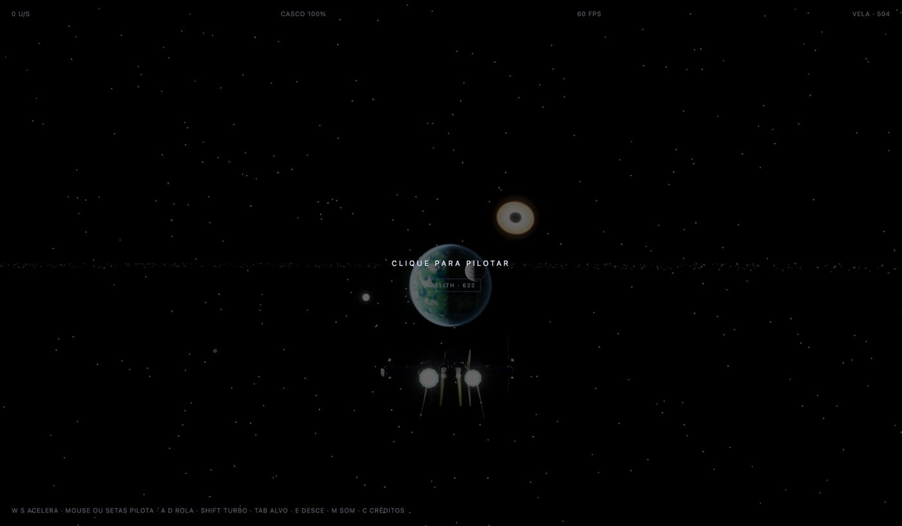
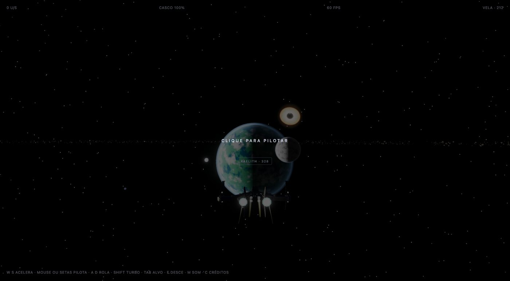
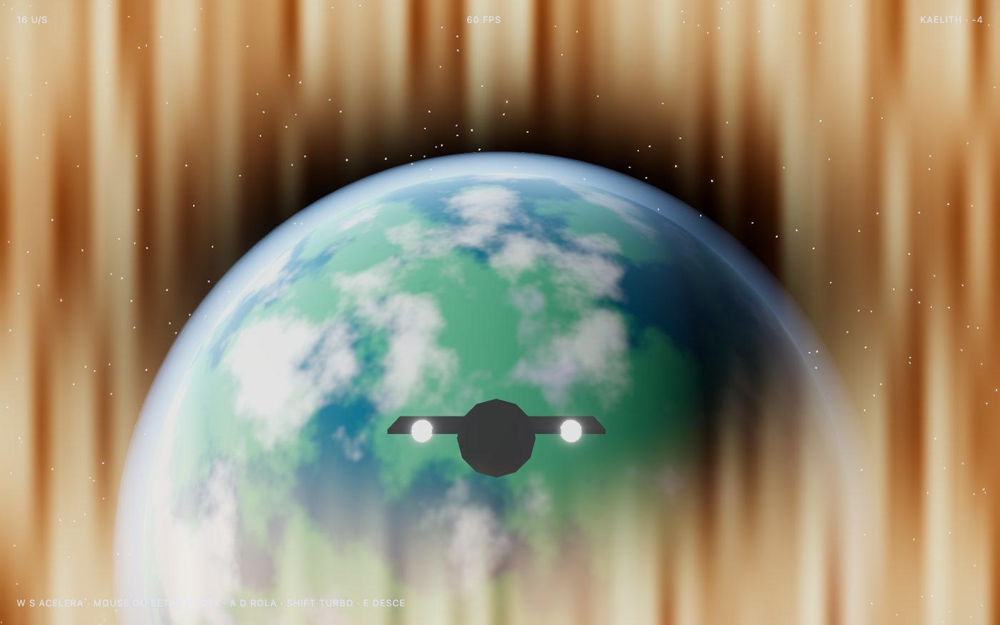
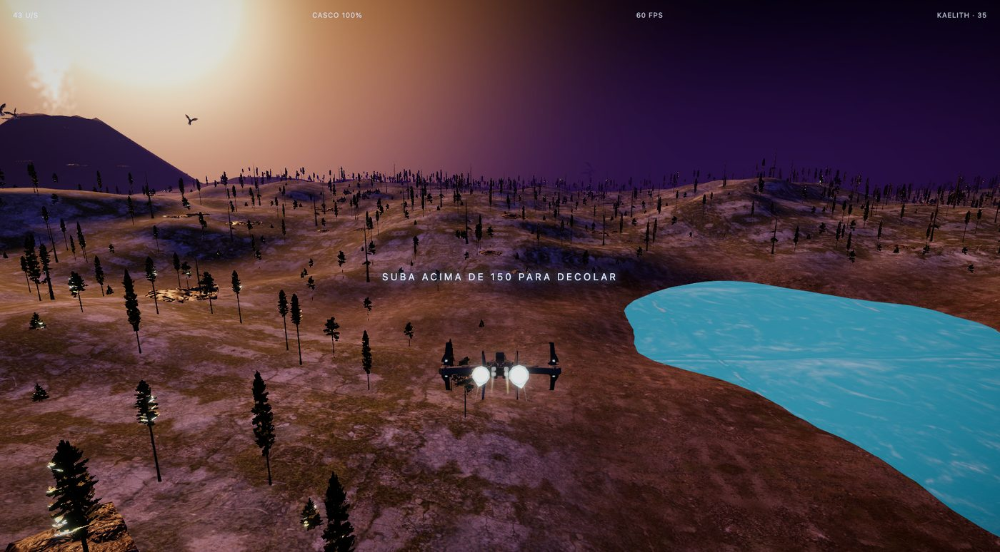
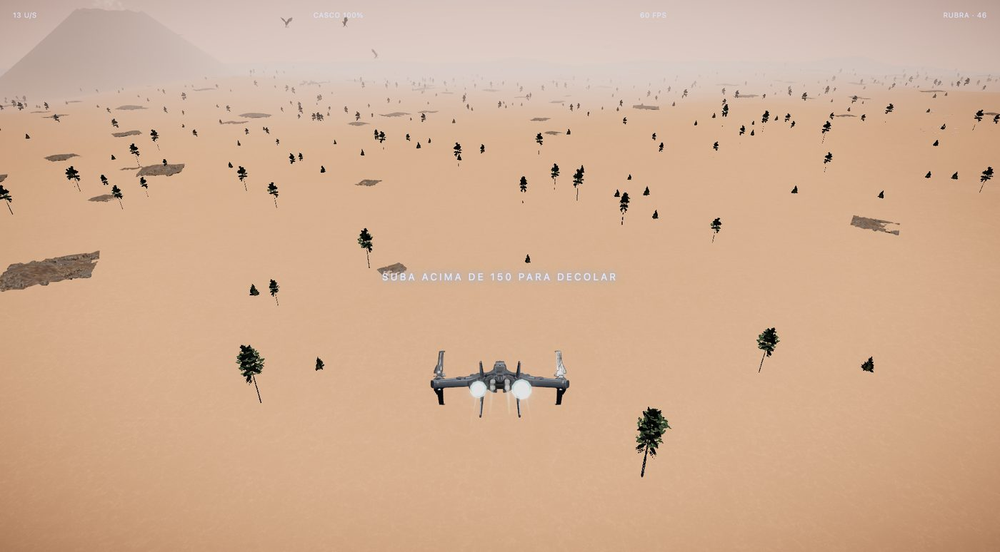
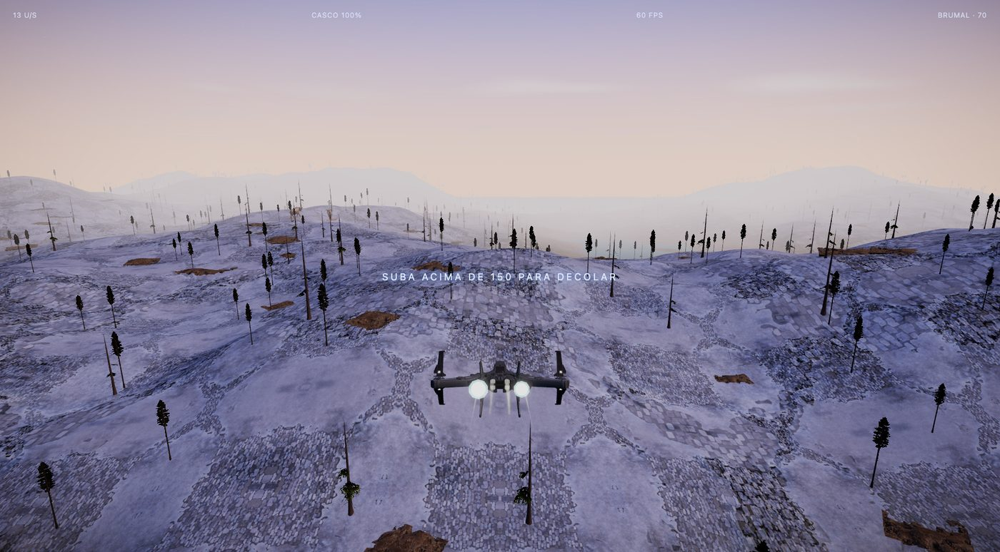
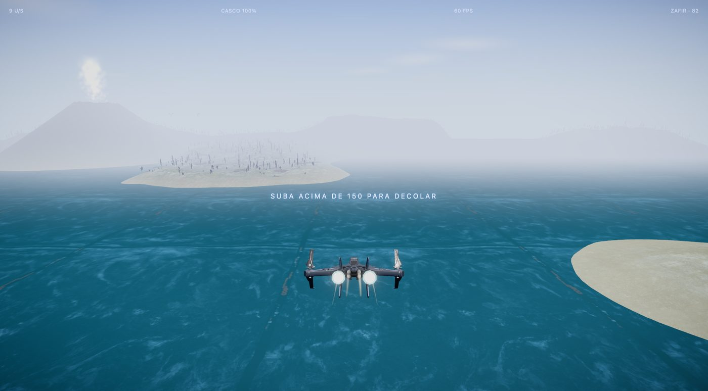
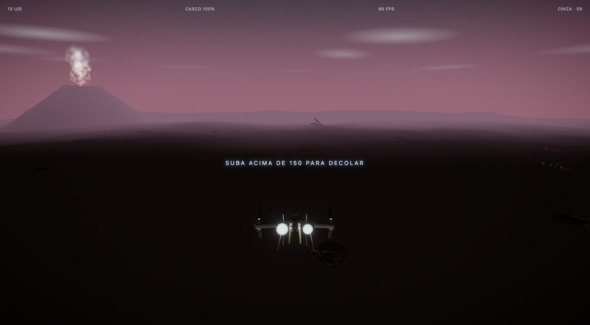
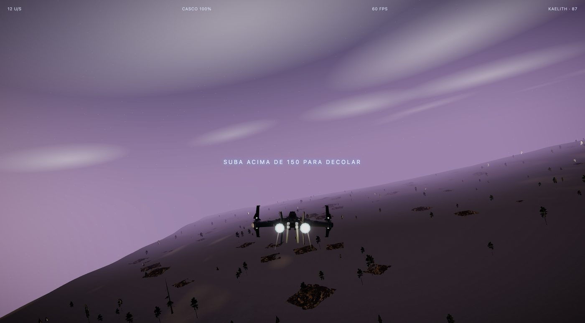
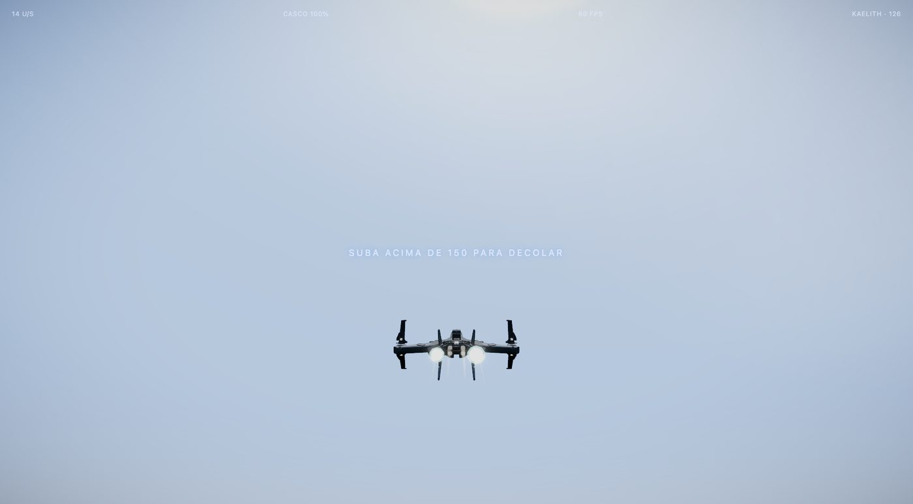

# Kaelith

Exploração espacial no navegador. Você pilota uma nave por um sistema solar completo, escolhe um planeta, atravessa a atmosfera e sobrevoa uma superfície viva, com biomas, clima, vulcões e bichos que fogem, caçam e atacam.

Feito com Three.js, Vite e TypeScript. Sem backend, sem arquivos de áudio: todo o som é sintetizado.



## O que tem

**Espaço**
- Sol com superfície animada e coroa, dez planetas em órbita real, três luas, anéis, cinturão de 2.500 asteroides, três cometas em elipses e um buraco negro com disco de acreção.
- Cada planeta tem paleta, nuvens e brilho próprios, gerados em shader. Gigantes gasosos ganham faixas.
- Navegação por alvo: **Tab** troca o corpo, o colchete mostra nome e distância e gruda na borda da tela quando o alvo sai do quadro.



**Pouso**
- Aponte para um planeta visitável e a nave desce sozinha, ou aperte **E** de perto.
- A transição é feita em shader: zoom do campo de visão, calor nas bordas, clarão branco e desfoque radial que se desfaz enquanto a superfície aparece.



**Cinco mundos visitáveis**, cada um com relevo, chão, céu, flora e fauna próprios:

| Mundo | Como é |
|---|---|
| Kaelith | mundo misto: oceano, lago, vulcão, deserto a oeste, floresta a leste |
| Rubra | deserto vermelho, dunas, vulcão, céu rosa empoeirado |
| Brumal | campos de neve, mar gelado, abetos, manhã pálida |
| Zafir | oceano com ilhas, selva, vulcão numa ilha |
| Cinza | planície de cinzas e lava, céu vermelho ao anoitecer |







**Ambiente**
- Dia de 6 minutos: sol, luz, céu, neblina e estrelas mudam entre noite, amanhecer, dia e entardecer.
- Clima em ciclo: limpo, nublado, chuva, tempestade com raios.
- Vulcões com lava pulsante, fumaça ao vento e dano ao casco se você pairar na cratera.




**Fauna**
- Bandos que pastam, debandam em leque quando a nave chega e voltam depois. Aves que sobem e se afastam.
- Predadores raros: inseto gigante, lagarto voador e uma matilha de goblins. Caçam a nave ou as presas da sua espécie, atacam em bote e recuo, e comem o que abatem.
- A nave tem casco. Cada golpe tira 20%, treme a câmera e acende o alerta com a distância do predador. Casco zerado vira decolagem de emergência, sem tela de morte.

## Como rodar

Precisa de Node 20 ou mais novo.

```sh
npm install
npm run dev
```

Abra a URL que o terminal mostrar. **Os modelos não vêm no repositório**; veja [docs/ASSETS.md](docs/ASSETS.md) para baixar cada um.

```sh
npm test         # lógica pura: voo, órbitas, terreno, bandos, predadores, clima, dia e noite
npm run build    # dist/ pronto para hospedagem estática
```

Parâmetros de URL úteis:

| Parâmetro | Efeito |
|---|---|
| `?hora=0.5` | abre ao meio-dia (`0.05` é noite) |
| `?em=rubra` | nasce ao lado de outro planeta (`brumal`, `zafir`, `cinza`) |
| `?dpr=2` | força resolução alta para estressar a GPU |

## Controles

| Tecla | Ação |
|---|---|
| Clique | trava o mouse |
| Mouse ou setas | pilota |
| W / S | acelera / freia |
| A / D | rolagem |
| Shift | turbo |
| Tab | troca o alvo de navegação |
| E | descer no planeta |
| M | liga e desliga o som |
| C | créditos |
| Esc | solta o mouse |

Na superfície, subir acima de 150 de altitude decola de volta ao espaço.

## Como foi feito

- **Three.js** com `postprocessing` para bloom, vinheta e tom ACES. Planetas, Sol, anéis, buraco negro, lava e céu são shaders. Rubra usa textura.
- **Terreno** gerado por ruído em heightmap, moldado por bioma e texturizado com quatro camadas (terra, musgo, rocha, neve) misturadas por altura e inclinação.
- **Vegetação** e rochas por instancing; modelos com vários materiais são fundidos por material.
- **Bichos com esqueleto** usam um clone por animal e misturam idle e corrida pela velocidade. Os sem esqueleto são instanciados e andam com balanço procedural.
- **Comportamento** em módulos puros e testados: bandos, aves, predadores, órbitas, clima, ciclo do dia, relevo.
- **Áudio** em Web Audio: estrondo de foguete (ruído filtrado, sub-grave e estalos), ambiente, ruído de reentrada e trovão.
- **Carga**: o espaço abre primeiro; cada superfície carrega em segundo plano quando a nave chega perto do planeta.

Decisões e orçamentos estão em [DECISIONS.md](DECISIONS.md). O desenho da fauna e do ambiente está em [WORLD.md](WORLD.md).

## Créditos

Nave, bichos, árvores, rochas e texturas são de artistas do Sketchfab, com crédito dentro do jogo (tecla **C**) e a lista completa com links e licenças em [docs/ASSETS.md](docs/ASSETS.md). Ruído simplex de Ashima Arts (MIT).
